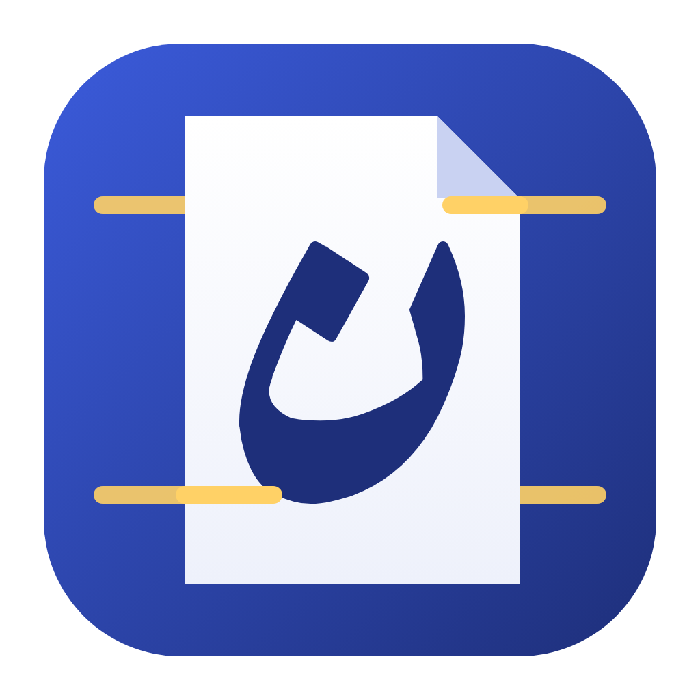
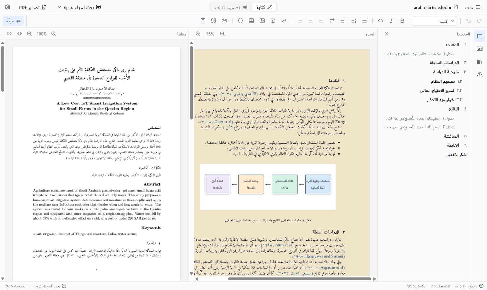
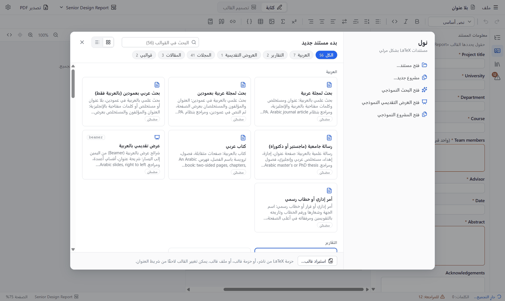
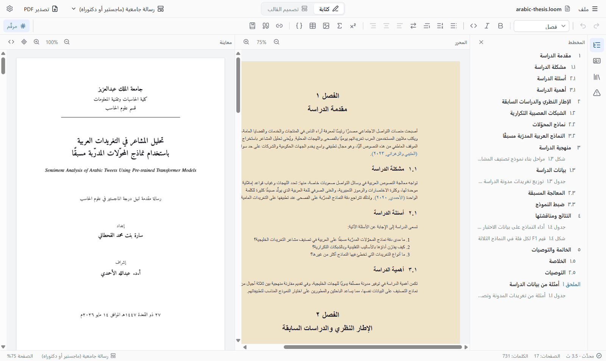
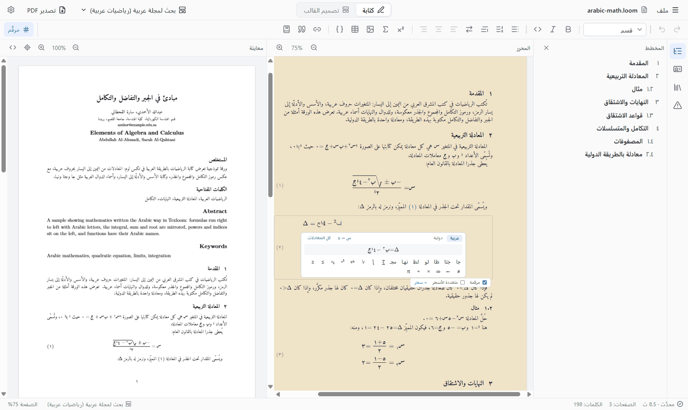
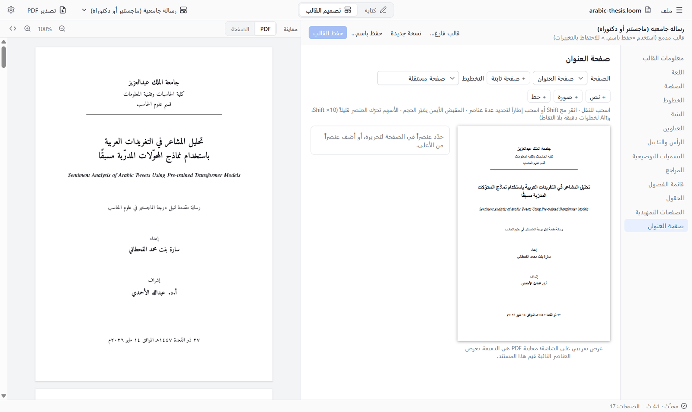
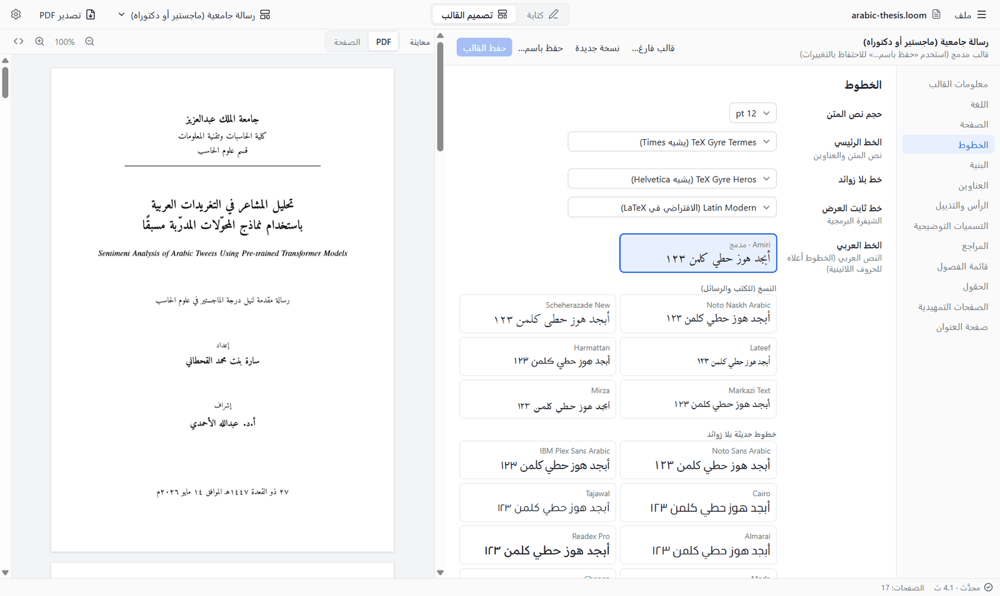
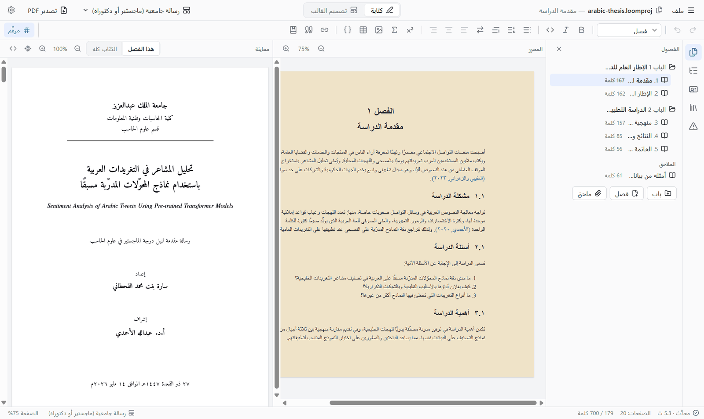
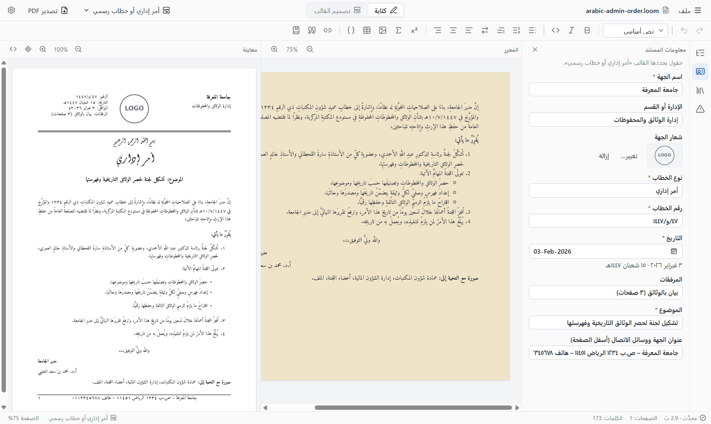
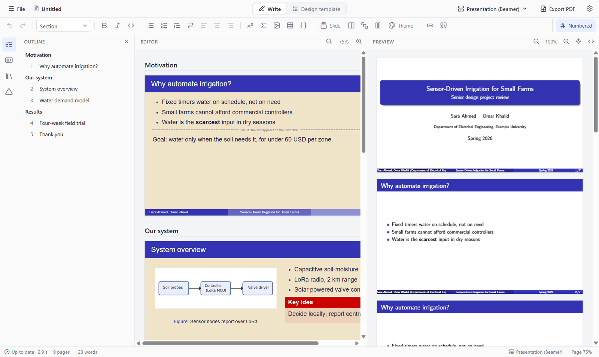

<p align="center"></p>

<h1 align="center">نول · Nawl</h1>

<p align="center" dir="rtl">
  محرر مرئي لمستندات LaTeX، بقوالب تصممها بلا كود.<br>
  العربية أولويته الأولى.
</p>

<p align="center">
  <a href="README.md">English</a> · <b>العربية</b> ·
  <a href="docs/help.md">User guide</a> · <a href="docs/help.ar.md">دليل الاستخدام</a>
</p>

<div dir="rtl">



نَوْل (وهو آلة النسيج) على نهج LyX: تكتب على صفحة تشبه النتيجة، ويكتب نول كود LaTeX ويعرض ملف
PDF بجوارها. أما القوالب (الصفحة والخطوط والعناوين وصفحة العنوان) فتُصمَّم بصريًا بلا
كود.

> **نسخة تجريبية مبكرة (الإصدار 0.1).** يصلح نول لمستندات حقيقية، لكنه برنامج
> ناشئ: توقّع بعض النواقص، واحتفظ بنسخ من عملك المهم. قد تتغير صيغ الملفات بين
> الإصدارات. ملفات التثبيت غير موقّعة رقميًا، فيعرض ويندوز تحذير SmartScreen عند
> التشغيل الأول. يُطوَّر ويُختبر على ويندوز وأوبونتو، ولم يُجرَّب على macOS. نرحب ببلاغات
> الأخطاء في [صفحة المشكلات](https://github.com/abdullah-alahmadi/nawl/issues).

## المحتويات

- [ما الذي يفعله](#ما-الذي-يفعله)
- [جولة بالصور](#جولة-بالصور)
- [التثبيت](#التثبيت)
- [التوثيق](#التوثيق)
- [البناء من المصدر](#البناء-من-المصدر)
- [سطر الأوامر](#سطر-الأوامر)
- [الحزم](#الحزم)
- [الاختبارات](#الاختبارات)
- [الترخيص](#الترخيص)

## ما الذي يفعله

- **كتابة كمحرر النصوص، وتنضيد بـ LaTeX.** عناوين وقوائم وأشكال وجداول ومعادلات
  وإحالات واستشهادات، مع معاينة PDF حية مرتبطة بالمحرر في الاتجاهين.
- **قوالب بلا كود.** مصمم مرئي للصفحة والخطوط والعناوين وصفحة العنوان والصفحات
  التمهيدية. وتعمل أصناف الناشرين (IEEE و Elsevier و ACM و Springer و APS) وأصناف
  تثبيت TeX لديك أيضًا.
- **العربية أولًا.** أبحاث ورسائل جامعية وكتب وأوامر إدارية وشرائح من اليمين إلى
  اليسار، ومكتبة من ٣١ خطًا عربيًا حرًا، ومراجع وتواريخ وأرقام عربية، وواجهة عربية.
- **الرياضيات العربية.** معادلات تُكتب من اليمين إلى اليسار، برموز تكامل ومجموع وجذر
  معكوسة وأسماء دوال عربية.
- **المشاريع.** رسالة أو كتاب في مشروع واحد بملف لكل فصل.
- **العروض التقديمية** بـ Beamer، والتصدير إلى PDF و LaTeX و Word.
- **لا حاجة إلى تثبيت شيء آخر.** محرك TeX (واسمه Tectonic) والحزم التي تحتاجها
  القوالب المدمجة تأتي مع البرنامج، فتُبنى المستندات بلا إنترنت.

## جولة بالصور

### ابدأ من قالب

تقارير ومقالات ومجلات ورسائل وكتب وعروض تقديمية، بالعربية والإنجليزية. وتظهر هنا
قوالبك الخاصة وأصناف TeX Live المثبتة أيضًا.



### اكتب وشاهد ملف PDF

صفحة المحرر تأخذ شكلها من القالب. تمتزج العربية والإنجليزية بحرية، ويجد نول
الكلمات الإنجليزية بنفسه ويبقي كل لغة في اتجاهها وخطها. انقر نقرًا مزدوجًا على PDF
للانتقال إلى الموضع نفسه في المحرر، و Ctrl+J للاتجاه المعاكس.



### الرياضيات العربية

تُكتب المعادلات من اليمين إلى اليسار، بحروف عربية ورموز معكوسة وأسماء دوال عربية.
ومساعد المعادلات يحوّل الحروف ويدرج الرموز العربية.



### صمّم القالب

لكل جزء من التخطيط لوحة، وصفحة العنوان لوحة تصميم بالسحب والإفلات.



ومعرض للخطوط العربية، كل خط بشكله:



### رسالة أو كتاب في فصول

المشروع يحفظ ملفًا لكل فصل. ويعمل الترقيم والإحالات والاستشهادات عبر الفصول.



### الخطابات الرسمية

أمر إداري بترويسة وتاريخين وتوقيع.



### العروض التقديمية

شرائح بـ Beamer بشكلها الحقيقي، مع كل سمات Beamer للاختيار منها.



## التثبيت

ملفات التثبيت مرفقة في
[صفحة الإصدارات](https://github.com/abdullah-alahmadi/nawl/releases): ملفا `.exe`
و `.msi` لويندوز، وملف `.deb` وحزمة snap لأوبونتو. إن لم يكن هناك إصدار منشور بعد
فابنِ البرنامج من المصدر كما في الأسفل.

ملف التثبيت في ويندوز غير موقّع رقميًا: اختر **More info** ثم **Run anyway** عند تحذير
SmartScreen.

## التوثيق

| | العربية | English |
|---|---|---|
| دليل الاستخدام بالصور | [docs/help.ar.md](docs/help.ar.md) | [docs/help.md](docs/help.md) |
| هذه الصفحة | [README.ar.md](README.ar.md) | [README.md](README.md) |
| ملاحظات مفصلة عن كل ميزة (بالإنجليزية) | | [docs/reference.md](docs/reference.md) |
| خطة العمل وملاحظات التصميم (بالإنجليزية) | | [PLAN.md](PLAN.md) |

في البرنامج: **ملف ← مساعدة** (F1) يفتح دليل الاستخدام بلغة الواجهة.

## البناء من المصدر

على أوبونتو:

</div>

```bash
sudo apt install -y build-essential curl wget file libwebkit2gtk-4.1-dev libxdo-dev libssl-dev libayatana-appindicator3-dev librsvg2-dev nodejs npm rustup
rustup default stable
npm install                 # also copies MathLive fonts into public/
scripts/fetch-tectonic.sh   # downloads Tectonic into src-tauri/binaries/
pip install fonttools && node scripts/fetch-fonts.mjs   # the Arabic font library (optional)
npm run tauri dev
```

<div dir="rtl">

على ويندوز: ثبّت Rust و Node.js و
[متطلبات Tauri](https://tauri.app/start/prerequisites/)، ثم نفّذ الأوامر نفسها من
Git Bash مع محرك ويندوز: `scripts/fetch-tectonic.sh x86_64-pc-windows-msvc`.

يستغرق البناء الأول دقيقة أو دقيقتين ريثما ينزّل Tectonic حزم TeX، ثم تُحفظ لديه. أما
ملفات التثبيت فتحمل الحزم التي تحتاجها القوالب المدمجة
(`node scripts/build-tex-cache.mjs`)، فتبني بلا إنترنت من أول تشغيل، وتُنزَّل الحزم
الأخرى عند الحاجة.

**محرك TeX** (الإعدادات ← المعاينة): يبني نول بمحرك Tectonic المدمج افتراضيًا.
وإذا كان TeX Live أو MiKTeX أو MacTeX مثبتًا فيمكن استخدام **pdfLaTeX** أو **XeLaTeX**
أو **LuaLaTeX** منه: يعمل بلا إنترنت، ويستخدم حزمك المثبتة، ويشغّل حزم الناشرين
المصممة لـ pdfLaTeX كما هي.

بنية الكود:

| المجلد | محتواه |
|---|---|
| `crates/core` | نموذج القالب والمستند، والتحقق |
| `crates/codegen` | من القالب إلى `.cls`، ومن المستند إلى `.tex` |
| `crates/compile` | تشغيل Tectonic أو TeX المثبت |
| `crates/docx` | تصدير Word |
| `crates/cli` | أداة سطر الأوامر |
| `src-tauri` | خلفية البرنامج |
| `src` | الواجهة (React و TipTap) |
| `templates` و `examples` | القوالب المدمجة والمستندات النموذجية |

## سطر الأوامر

</div>

```bash
cargo run -p nawl-cli -- render examples/arabic-thesis.loom -t templates/arabic-thesis/template.json -o thesis.pdf
cargo run -p nawl-cli -- export examples/arabic-thesis.loom -t templates/arabic-thesis/template.json --out-dir build/
cargo run -p nawl-cli -- check templates/arabic-thesis/template.json --print-cls
```

<div dir="rtl">

## الحزم

تبني GitHub Actions ملفات التثبيت (`.github/workflows/packages.yml`): ملف `.deb`
لأوبونتو (يُبنى على 22.04 فيعمل عليه وعلى ما بعده)، وحزمة snap منه، وملفي التثبيت
لويندوز (`.exe` و `.msi`). شغّل مسار **Packages** من تبويب Actions، أو ادفع وسم إصدار
لتحصل أيضًا على مسودة إصدار مرفقة بها الحزم:

</div>

```bash
git tag v0.1.0
git push origin v0.1.0
```

<div dir="rtl">

للبناء محليًا: `npm run tauri build -- --bundles deb` على لينكس، و
`npm run tauri build -- --bundles nsis,msi` على ويندوز، بعد تنزيل Tectonic والخطوط
وحزم TeX كما في [README الإنجليزي](README.md#packages).

## الاختبارات

كل دفع إلى `main` يشغّل الاختبارات على GitHub (`.github/workflows/tests.yml`).

</div>

```bash
cargo test --workspace            # also regenerates src/bindings/*.ts
npx tsc --noEmit -p .             # frontend type check
NAWL_TECTONIC=$PWD/src-tauri/binaries/tectonic-x86_64-unknown-linux-gnu cargo test --workspace -- --ignored   # real compiles
```

<div dir="rtl">

## الترخيص

نول مرخّص برخصة [Apache License, Version 2.0](LICENSE).
حقوق النشر 2026 Abdullah Al-Ahmadi.

تحمل ملفات التثبيت أيضًا برمجيات وخطوطًا لآخرين برخصها الخاصة: Tectonic و MathLive
(رخصة MIT)، وحزم TeX (أغلبها برخصة LaTeX Project Public License)، ومكتبة الخطوط
العربية (انظر [NOTICE](NOTICE)).

</div>
