

# دليل استخدام نول

[English](help.md) · **العربية**

نول محرر مرئي لمستندات LaTeX. تكتب على صفحة تشبه النتيجة، ويتولى نول إنتاج
كود LaTeX وملف PDF. يشرح هذا الدليل كل جزء في البرنامج. الصور من الإصدار 0.1.

## المحتويات

1. [البداية](#1-البداية)
2. [النافذة](#2-النافذة)
3. [الكتابة](#3-الكتابة)
4. [المعادلات](#4-المعادلات)
5. [الأشكال والجداول وكود LaTeX](#5-الأشكال-والجداول-وكود-latex)
6. [المراجع والاستشهادات والإحالات](#6-المراجع-والاستشهادات-والإحالات)
7. [معلومات المستند](#7-معلومات-المستند)
8. [المعاينة](#8-المعاينة)
9. [أمور للمراجعة وأخطاء LaTeX](#9-أمور-للمراجعة-وأخطاء-latex)
10. [البحث والاستبدال](#10-البحث-والاستبدال)
11. [القوالب](#11-القوالب)
12. [تصميم القالب](#12-تصميم-القالب)
13. [المستندات العربية](#13-المستندات-العربية)
14. [الرياضيات العربية](#14-الرياضيات-العربية)
15. [المشاريع: رسالة أو كتاب في فصول](#15-المشاريع-رسالة-أو-كتاب-في-فصول)
16. [العروض التقديمية](#16-العروض-التقديمية)
17. [الحفظ والتصدير](#17-الحفظ-والتصدير)
18. [الإعدادات](#18-الإعدادات)
19. [اختصارات لوحة المفاتيح](#19-اختصارات-لوحة-المفاتيح)
20. [عند حدوث مشكلة](#20-عند-حدوث-مشكلة)

---

## 1. البداية

**التثبيت.** نزّل ملف التثبيت المناسب لنظامك من
[صفحة الإصدارات](https://github.com/abdullah-alahmadi/nawl/releases): ملف `.exe` أو
`.msi` لويندوز، وملف `.deb` أو حزمة snap لأوبونتو. إن لم يكن هناك إصدار منشور بعد
فابنِ البرنامج من المصدر كما يشرح [ملف README](../README.md#building-from-source).
ملف التثبيت في ويندوز غير موقّع رقميًا، فيعرض ويندوز تحذير SmartScreen في المرة
الأولى: اختر **More info** ثم **Run anyway**.

لا تحتاج إلى تثبيت شيء آخر. محرك TeX (واسمه Tectonic) والحزم التي تحتاجها القوالب
المدمجة تأتي مع البرنامج، فتُبنى المستندات بلا إنترنت.

**نافذة البداية.** يفتح نول على نافذة البداية.

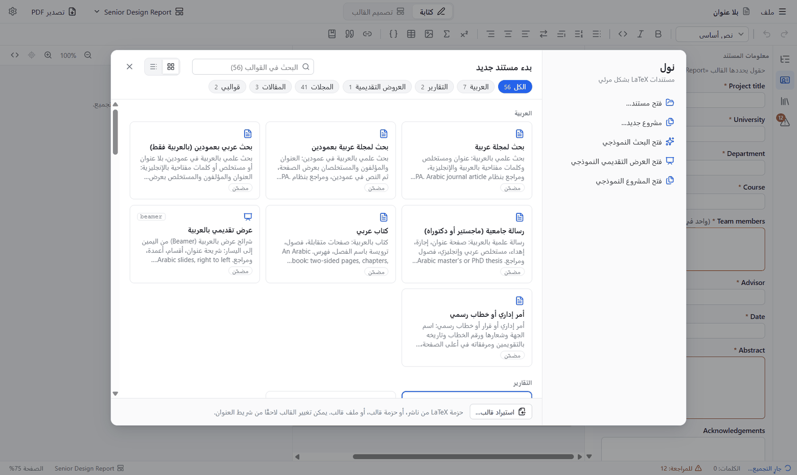

- **اختر قالبًا** لتبدأ مستندًا جديدًا. الأزرار في الأعلى (العربية، التقارير، العروض
  التقديمية، المجلات، المقالات، قوالبي) تضيّق القائمة، وخانة البحث تبحث في كل القوالب.
- في الجانب: **فتح مستند…** و**مشروع جديد…** (كتاب أو رسالة بملف لكل فصل)، وثلاثة
  أمثلة للتجربة: تقرير وعرض تقديمي ومشروع. وتظهر هنا الملفات الأخيرة أيضًا.
- اضغط **Esc** لإغلاق النافذة والبدء بصفحة فارغة.

أفضل خطوة أولى أن تفتح أحد الأمثلة: فيه عناوين وشكل وجدول ومعادلات واستشهادات.

## 2. النافذة

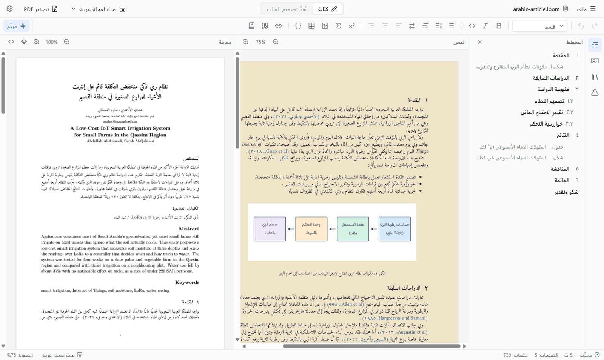

| الجزء | وظيفته |
|---|---|
| **شريط العنوان** | قائمة **ملف**، واسم المستند، ومفتاح **كتابة / تصميم القالب**، وزر القالب (ينقل المستند إلى قالب آخر)، و**تصدير PDF**، و**الإعدادات**. |
| **شريط الأدوات** | التراجع والإعادة، ونمط الفقرة، والغامق والمائل والكود، والقوائم، واتجاه النص، والمحاذاة، وأزرار الإدراج (صيغة، معادلة، شكل، جدول، كود LaTeX، إحالة، استشهاد، الملاحق). |
| **الشريط الجانبي** | يفتح لوحة جانبية: **المخطط**، **معلومات المستند**، **المراجع**، **أمور للمراجعة**. وفي المشروع تُضاف لوحة **الفصول**. |
| **المحرر** | الصفحة التي تكتب عليها. يأخذ شكلها من القالب فتشبه ملف PDF. في رأسها أزرار تكبير المحرر وتصغيره. |
| **المعاينة** | ملف PDF الحقيقي، يُبنى وأنت تكتب. في رأسها التكبير والتصغير، وزر إظهار موضع المؤشر في PDF، وزر إظهار كود LaTeX. |
| **شريط الحالة** | حالة البناء، وعدد الصفحات والكلمات، وعدد الأمور التي تحتاج مراجعة، والقالب، وتكبير الصفحة. |

في الواجهة العربية تنعكس النافذة كلها: الشريط الجانبي على اليمين والمعاينة على
اليسار. وفي الواجهة الإنجليزية العكس.

## 3. الكتابة

اكتب كما تكتب في أي محرر نصوص. يحدد القالب شكل ما تكتبه.

**نمط الفقرة.** الخانة في أول شريط الأدوات تحدد نوع الفقرة الحالية: *نص أساسي*،
*فصل*، *قسم*، *قسم فرعي* وهكذا. تُرقَّم العناوين تلقائيًا، وتعرضها لوحة **المخطط**؛
انقر عنوانًا للانتقال إليه.

**مرقَّم أو غير مرقَّم.** والمؤشر في عنوان، يلغي زر **مرقَّم** في طرف شريط الأدوات رقمه
(لصفحة الشكر أو التمهيد مثلًا). ويبقى العنوان في فهرس المحتويات.

**تنسيق الحروف.** **غامق** (Ctrl+B) و*مائل* (Ctrl+I) و`كود` (Ctrl+E).

**القوائم والاقتباس.** قائمة نقطية، وقائمة مرقمة، واقتباس. اضغط Tab لإدخال بند في
مستوى أعمق، و Shift+Tab لإعادته.

**المحاذاة.** ثلاثة أزرار تحاذي الفقرة إلى اليسار أو الوسط أو اليمين. انقر الزر
المفعّل مرة أخرى للعودة إلى محاذاة القالب (وهي الضبط من الجهتين غالبًا).

**اتجاه النص.** زر الاتجاه (أو **Ctrl+Shift+X**) ينقل الفقرة بين اليمين إلى اليسار
واليسار إلى اليمين. انظر [المستندات العربية](#13-المستندات-العربية).

**المسافات والأسطر الفارغة.** يتجاهل LaTeX المسافات المتكررة والأسطر الفارغة، فلا
يسمح نول بتكديسها: الضغط على Enter في سطر فارغ لا يفعل شيئًا، والمسافة الثانية
تُهمل، والنص الملصوق تُختصر مسافاته المتتالية إلى واحدة. أما الكود فيحتفظ بكل مسافة.

**الملاحق.** آخر زر في شريط الأدوات يبدأ الملاحق. الفصول التي بعده تُرقَّم بالحروف
(الملحق أ، ب…).

## 4. المعادلات

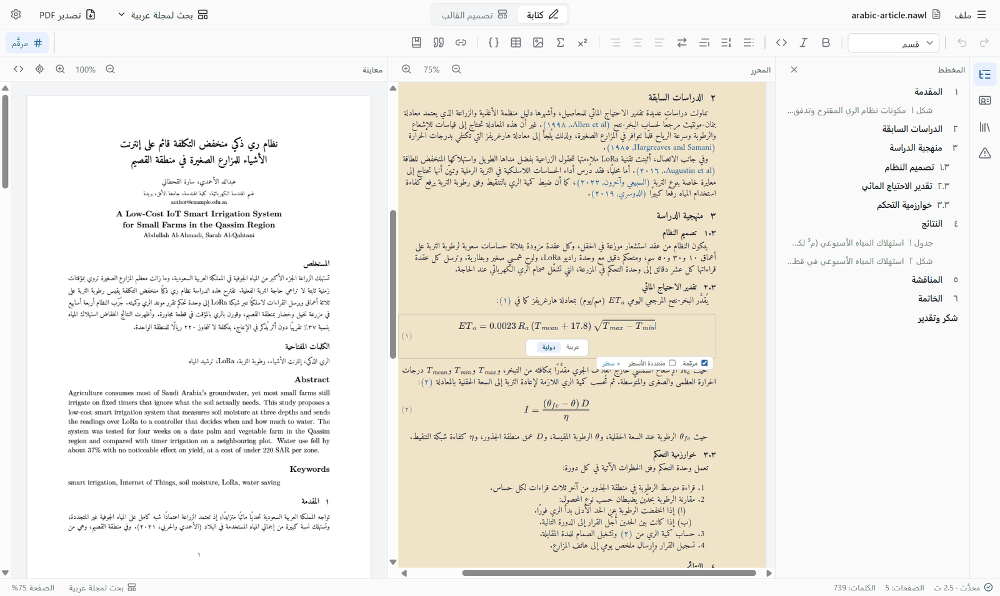

- **صيغة داخل السطر:** اضغط **Ctrl+M**، أو اكتب `$x^2$` داخل الجملة.
- **معادلة في سطر مستقل:** اكتب `$$` ثم مسافة، أو استخدم زر Σ.
- انقر المعادلة لتحريرها. يمكنك كتابة أوامر LaTeX (مثل `\frac` و `\sqrt` و `\alpha`)
  أو استخدام لوحة المفاتيح: `/` للكسر، و `^` للأس، و `_` للدليل السفلي.
- مرّر المؤشر فوق المعادلة لتظهر أدواتها: **مرقّمة** لإظهار الرقم أو إخفائه،
  و**متعددة الأسطر** لاشتقاق متحاذٍ، و**+ سطر** لإضافة سطر.
- يمكن الإحالة إلى المعادلات المرقمة، فتظهر الإحالة بصورة "(٢.٣)".

للكتابة بالرموز العربية انظر [الرياضيات العربية](#14-الرياضيات-العربية).

## 5. الأشكال والجداول وكود LaTeX

**الأشكال.** زر الصورة يطلب ملف صورة (PNG أو JPG أو PDF). اكتب التعليق تحتها. شريط
التمرير تحت الصورة يحدد عرضها، و**اقتصاص…** يقص أطرافها بالسحب. تُنسخ الصور إلى
مجلد `figures/` بجوار المستند.

**الجداول.** زر الجدول يدرج جدولًا وفوقه تعليقه. والمؤشر داخل الجدول تظهر في طرف
شريط الأدوات أزرار إضافة الصفوف والأعمدة وحذفها. اسحب فوق عدة خلايا ثم اضغط زر
الدمج لضمّها، عبر الصفوف والأعمدة.

**كود LaTeX.** زر `{ }` يدرج قالبًا يُكتب في ملف PDF كما هو. استخدمه لرسوم TikZ أو
لأي شيء ليس له زر في نول.

## 6. المراجع والاستشهادات والإحالات

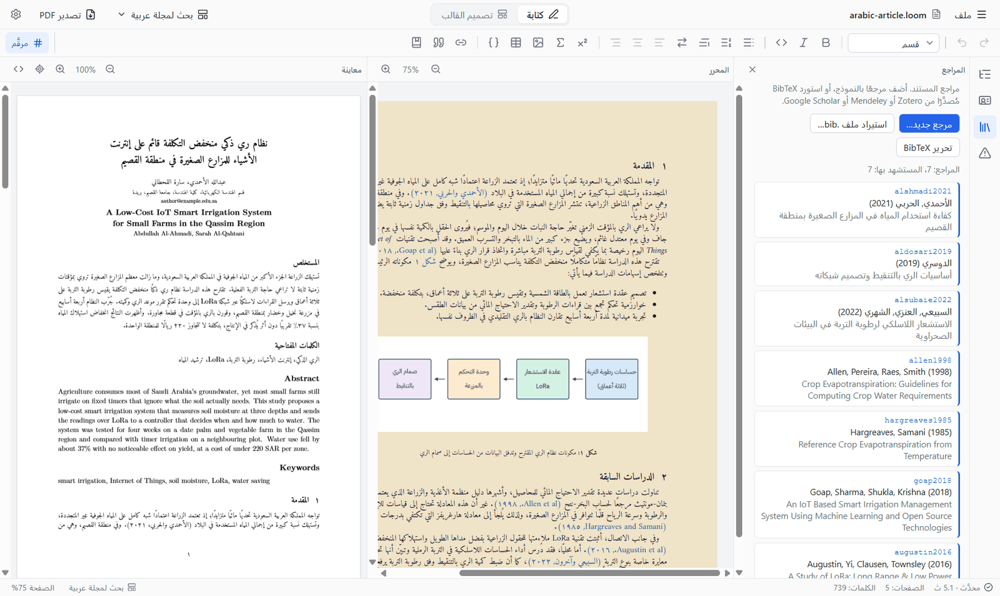

**قائمة المراجع.** افتح **المراجع** من الشريط الجانبي.

- **مرجع جديد…** يفتح نموذجًا لمقالة في مجلة أو ورقة مؤتمر أو كتاب أو فصل أو رسالة
  أو تقرير أو موقع، بصف لكل مؤلف. يُصنع مفتاح الاستشهاد من المؤلف الأول والسنة
  والعنوان.
- **استيراد ملف .bib…** و**تحرير BibTeX** يقبلان مراجع مصدّرة من Zotero أو Mendeley
  أو Google Scholar.
- انقر مرجعًا لتعديله أو حذفه.

**الاستشهاد.** ضع المؤشر في موضع الاستشهاد واضغط زر الاستشهاد ثم اختر المرجع. يحدد
القالب الأسلوب (أرقام IEEE، أو المؤلف والسنة، أو APA…)، وتُطبع قائمة المراجع في آخر
المستند. المراجع العربية تُنسَّق بالعربية (وآخرون، د.ت.) والإنجليزية بالإنجليزية.

**الإحالات.** زر الرابط يدرج "الشكل ١.٣" أو "الفصل ٢" أو "الجدول ١.٣" أو "(٢.٣)".
يبقى الرقم صحيحًا إذا تحركت العناصر. انقر الإحالة مع Ctrl للانتقال إلى ما تشير إليه.

## 7. معلومات المستند

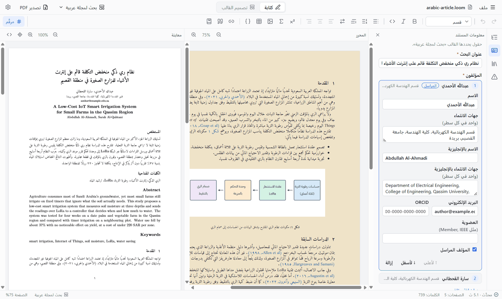

العنوان والمؤلفون والمستخلص والمشرف والتاريخ ونحوها لا تُكتب على الصفحة. هي **حقول**
يعرّفها القالب، وتُملأ في **معلومات المستند** من الشريط الجانبي. يضعها القالب في صفحة
العنوان والصفحات التمهيدية. الحقول ذات النجمة الحمراء مطلوبة.

في قوالب المجلات صف لكل مؤلف فيه جهة الانتماء والبريد الإلكتروني و ORCID والمؤلف
المراسل. وفي القوالب العربية لكل مؤلف اسم وجهة بالإنجليزية أيضًا. حقل **التاريخ** له
منتقي تاريخ، وحقل **الصورة** (شعار الجامعة مثلًا) يتيح اختيار صورة.

## 8. المعاينة

المعاينة هي ملف PDF الحقيقي. يُعاد بناؤه بعد توقفك عن الكتابة بقليل.

- **انقر نقرًا مزدوجًا على PDF** لوضع المؤشر في الموضع نفسه في المحرر.
- **Ctrl+J** (أو زر الهدف) يمرّر PDF إلى موضع المؤشر ويعلّمه.
- أزرار التكبير والتصغير و**ملاءمة العرض** في رأس المعاينة. وللمحرر أزراره في رأسه.
- زر إظهار كود LaTeX (`<>`) يعرض الكود الذي يكتبه نول، ومعه زر **نسخ الكود**.
- للبناء عند الطلب فقط، أوقف البناء أثناء الكتابة من **الإعدادات ← المعاينة** واضغط
  **Ctrl+Enter**.

## 9. أمور للمراجعة وأخطاء LaTeX

لوحة **أمور للمراجعة** في الشريط الجانبي (والعدد في شريط الحالة) تعرض ما ينقص
المستند: حقول مطلوبة فارغة، وإحالات زال هدفها، واستشهادات بلا مرجع. انقر بندًا
للانتقال إليه.

وإذا أبلغ LaTeX عن خطأ، تشرح القائمة فوق المعاينة معناه المعتاد وموضعه. انقره
للانتقال إليه.

## 10. البحث والاستبدال

**Ctrl+F** يبحث في العناوين والفقرات والتعليقات والجداول. و **Ctrl+H** يستبدل أيضًا،
مطابقة واحدة أو الكل دفعة واحدة (وتراجع واحد يعيدها كلها).

يتجاهل البحث في النص العربي التشكيل والتطويل، ويعدّ أ إ آ ا حرفًا واحدًا وكذلك ة/ه
و ى/ي، فالبحث عن "محمد" يجد "مُحَمَّدٌ". خيار المطابقة التامة يوقف ذلك.

## 11. القوالب

القالب يحدد الصفحة والخطوط والعناوين وصفحة العنوان والصفحات التمهيدية والحقول.
يتذكر المستند قالبه، ويمكنك تغييره في أي وقت من زر القالب في شريط العنوان.

**ملف ← جديد من قالب…** (Ctrl+Shift+N) يفتح معرض القوالب:

| النوع | القوالب |
|---|---|
| العربية | بحث لمجلة (بعمود وبعمودين)، رسالة جامعية، كتاب، أمر إداري، عرض تقديمي |
| التقارير | Senior Design Report، Engineering Graduation Project Report |
| المقالات | Article، Two-column Article، Short Paper |
| المجلات | مجلات ومؤتمرات IEEE، Elsevier، ACM، Springer LNCS، APS |
| العروض التقديمية | عرض Beamer |
| قوالبي | ما صممته أو استوردته |
| من تثبيت TeX لديك | أصناف TeX Live المثبتة، مصنفة حسب نوعها |

قوالب المجلات تستخدم الصنف الرسمي للناشر، فيكون التخطيط تخطيط الناشر تمامًا. ويكتب
نول العنوان والمؤلفين والمستخلص والكلمات المفتاحية والمراجع بصيغة الناشر.

**استيراد قالب…** يضيف قالبًا إلى قوالبي. يقبل حزمة LaTeX من ناشر (ملف .zip من
إرشادات المؤلفين في المجلة)، أو حزمة قالب صدّرها أحد من نول، أو ملف قالب.
و**تصدير القالب…** يحفظ القالب الحالي ملف .zip للمشاركة.

## 12. تصميم القالب

انتقل إلى **تصميم القالب** في الأعلى. كل تغيير يحدّث المعاينة، وتظهر المشكلات بجوار
العنصر الذي سببها.

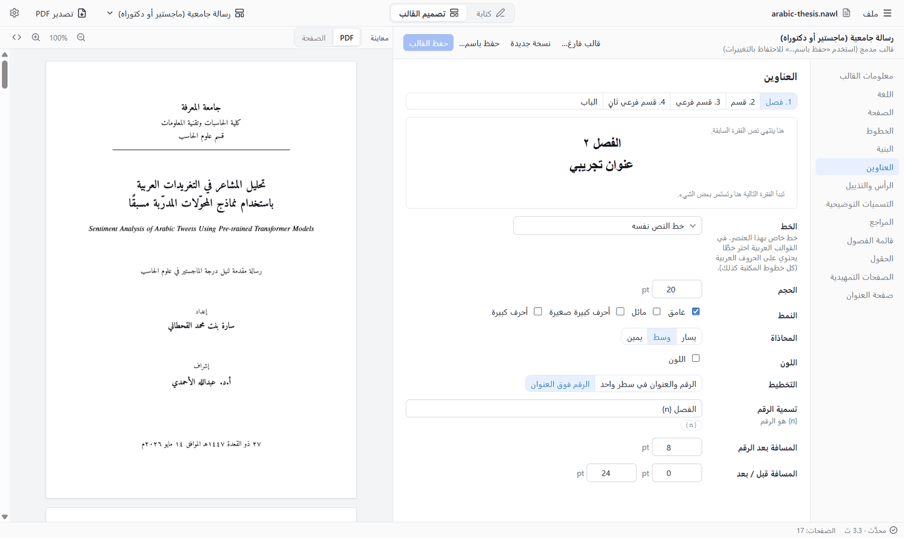

| القسم | ما تضبطه فيه |
|---|---|
| معلومات القالب | الاسم والوصف |
| اللغة | اللغة الرئيسية والثانية، والأرقام، وطريقة كتابة المعادلات |
| الصفحة | الورق، والهوامش، وعمود أو عمودان، وتباعد الأسطر |
| الخطوط | خط النص والخط العربي وغيرهما، والحجم |
| البنية | فصول أو أقسام في المستوى الأعلى، وعمق الترقيم، وصفحات الأغلفة |
| العناوين | خط كل مستوى وحجمه ومحاذاته ولونه وتسميته وتباعده |
| الرأس والتذييل | ما يظهر في أعلى كل صفحة وأسفلها |
| التعليقات | تسميات الأشكال والجداول وشكلها |
| المراجع | أسلوب الاستشهاد، وقائمة لكل لغة |
| قائمة الفصول | شكل الفصول والأبواب في المشروع |
| الحقول | حقول معلومات المستند |
| الصفحات التمهيدية | المستخلص، والشكر، والمحتويات، وقوائم الأشكال والجداول |
| صفحة العنوان | لوحة تصميم بالسحب والإفلات |

**صفحة العنوان** لوحة تصميم. أضف نصوصًا وصورًا وخطوطًا، واسحبها إلى مواضعها، واضبط
نصها وشكلها من الجانب. تلتصق العناصر بمنتصف الصفحة وهوامشها وببعضها. يمكن أن يحتوي
النص على حقول مثل `{title}` أو `{supervisor}`. و**+ صفحة ثابتة** يضيف صفحة أخرى
بالطريقة نفسها: صفحة إجازة أو إقرار.

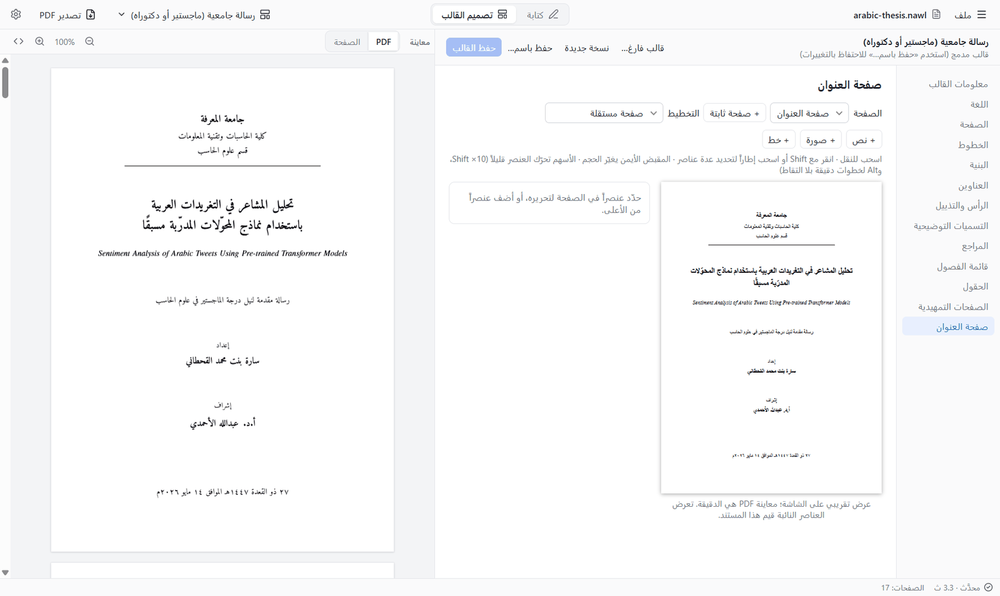

**الحفظ.** القوالب المدمجة لا تُعدَّل في مكانها. **نسخة جديدة** يبدأ نسخة من القالب
الحالي، و**قالب فارغ…** يبدأ من قالب خالٍ. و**حفظ باسم…** يحفظه في **قوالبي** فيظهر
في المعرض.

## 13. المستندات العربية

صُمم نول والعربية أولويته الأولى. تُنضَّد المستندات العربية والمختلطة من اليمين
إلى اليسار، بخطوط وعناوين وتسميات وأرقام ومراجع عربية.

**الواجهة.** **الإعدادات ← المظهر ← اللغة** ينقل الواجهة إلى العربية. وهي تتبع لغة
النظام افتراضيًا.

**القوالب.** في قسم **العربية** من المعرض: بحث لمجلة (بعمود وبعمودين)، ورسالة
جامعية، وكتاب، وأمر إداري، وعرض تقديمي. ويمكن جعل أي قالب عربيًا من قسم **اللغة** في
المصمم.

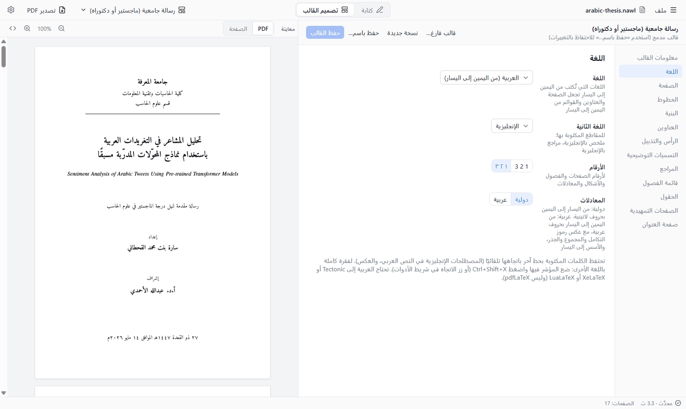

**الكتابة.** اكتب العربية والإنجليزية بحرية. يجد نول الكلمات الإنجليزية ويعلّمها
لـ LaTeX بنفسه. ولفقرة كاملة باللغة الأخرى اضغط **Ctrl+Shift+X**. في النص العربي
تتحول `?` و `,` و `;` و `"` إلى ؟ و ، و ؛ و «»، وتحتفظ الكلمات الإنجليزية والأرقام
بعلاماتها. يمكن إيقاف ذلك من الإعدادات ← المحرر.

**الخطوط.** قسم **الخطوط** في المصمم يعرض ٣٢ خطًا عربيًا، كل خط بشكله: Amiri (وهو
الافتراضي) و٣١ خطًا حرًا تأتي مع نول. تُرفق ملفاتها بالمستند فيظهر بالشكل نفسه
على أي حاسوب. وتعمل الخطوط المثبتة في النظام أيضًا. ويمكن أن يكون لكل عنوان ولكل
عنصر في صفحة العنوان خطه الخاص.

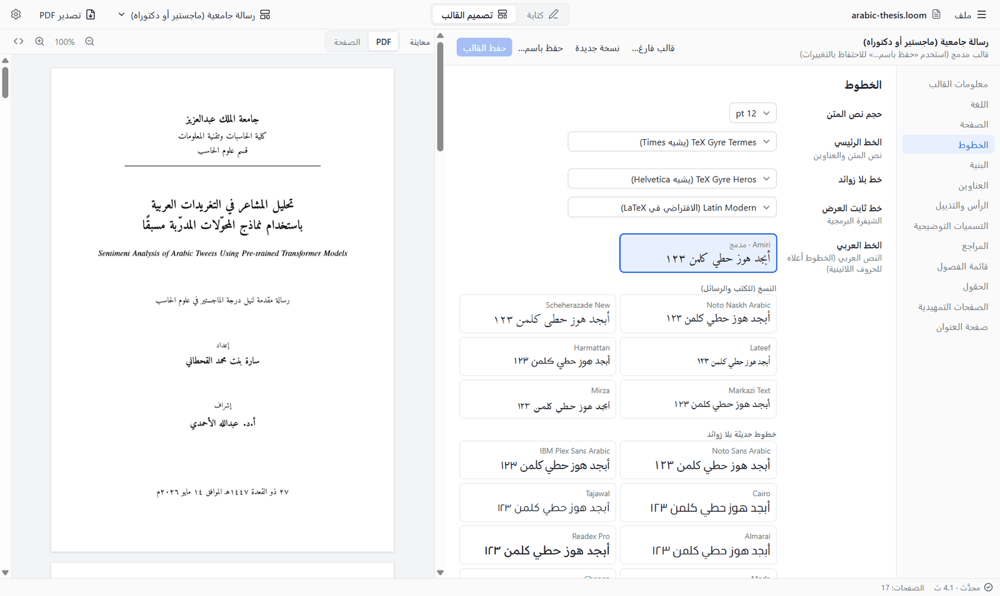

**الأرقام.** قسم اللغة يختار الأرقام العربية المشرقية (١٢٣) أو الغربية (123) لأرقام
الصفحات والفصول والأشكال والمعادلات. وتُقرأ أرقام الأقسام ورقم الفصل على اليمين:
القسم ١ من الفصل ٢ يُكتب ١.٢.

**المراجع.** يمكن أن يطبع القالب قائمة لكل لغة: المراجع العربية ثم الأجنبية. وتُرتَّب
الأسماء العربية بلا "ال" التعريف.

**التواريخ.** حقل التاريخ يُكتب بلغة المستند، ويمكن إظهاره بالتقويم الهجري (أم القرى)
أيضًا.

**الرسائل الجامعية.** قالب الرسالة فيه صفحة عنوان وصفحة إجازة ومستخلصان بالعربية
والإنجليزية وفصول.

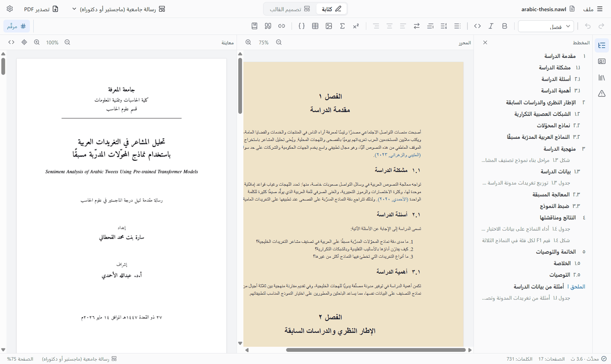

**الأوامر الإدارية.** قالب الأمر الإداري فيه ترويسة بالشعار، والرقم والتاريخ
بالتقويمين، والموضوع، والنص، والتوقيع.

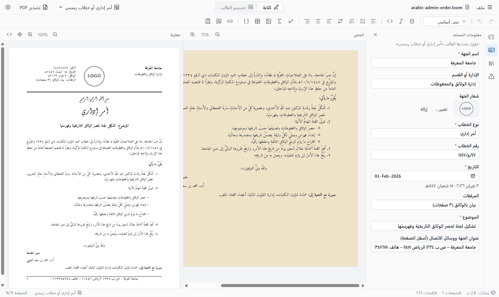

**المحركات.** تحتاج العربية إلى XeLaTeX أو LuaLaTeX. والمحرك المدمج هو XeLaTeX فلا
حاجة إلى ضبط شيء. أما الشرائح العربية فتحتاج إلى LuaLaTeX من تثبيت TeX Live أو
MiKTeX.

## 14. الرياضيات العربية

يمكن كتابة المعادلات بالطريقة العربية: من اليمين إلى اليسار، برموز تكامل ومجموع وجذر
ونهاية معكوسة، وأسماء دوال عربية (جا، جتا، ظا، لو، نهـــا)، ومتغيرات بخط خاص بها.

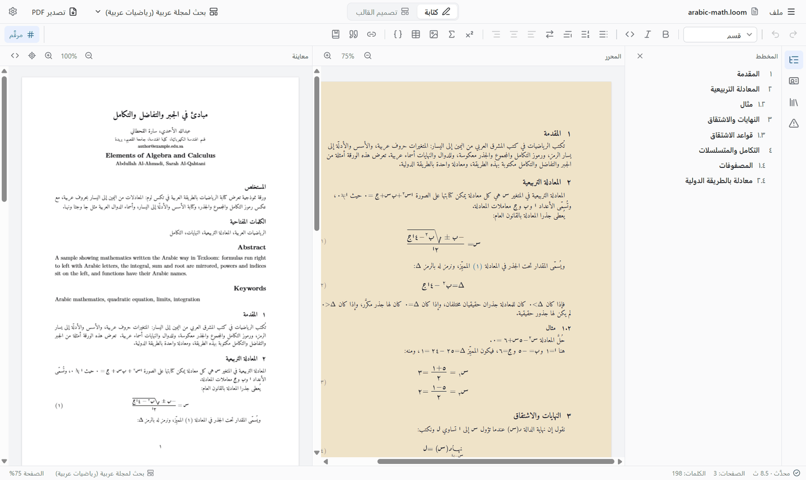

**التفعيل.** في قسم **اللغة** من المصمم اجعل **المعادلات** **عربية**. ويُختار هناك خط
المتغيرات أيضًا (الافتراضي Aref Ruqaa، لتتميز الحروف عن النص). وعند تغيير الإعداد
يعرض نول تحويل حروف المعادلات الموجودة في المستند (x ← س أو العكس).

**معادلة واحدة.** انقر المعادلة ليظهر مساعدها. **عربية / دولية** ينقل هذه المعادلة
بين الطريقتين أيًّا كان إعداد القالب. ولوحة الرموز تدرج أسماء الدوال والرموز العربية،
وزر **س ← x** يحوّل حروف هذه المعادلة أو كل المعادلات.

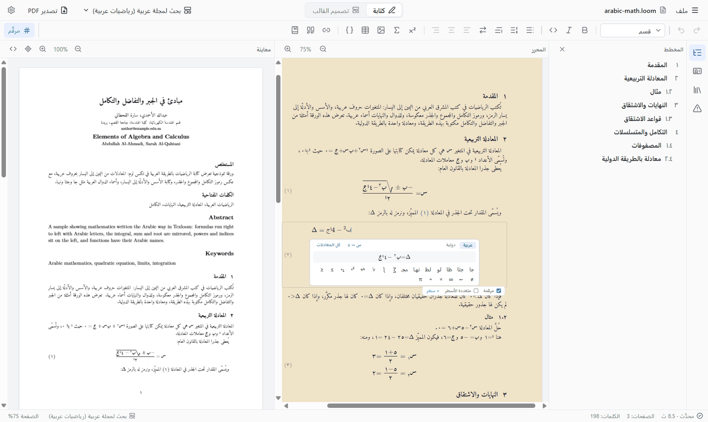

**في Word.** لا يستطيع Word تنضيد هذه المعادلات، فيضعها تصدير Word صورًا.

**الحدود.** الرياضيات العربية في الشرائح غير مجرَّبة. المثال
`examples/arabic-math.nawl` يبيّن ما هو مدعوم.

## 15. المشاريع: رسالة أو كتاب في فصول

المستند الطويل يمكن أن يكون **مشروعًا**: مجلدًا فيه ملف المشروع (`.nawlproj`) وملف
لكل فصل. يُفتح كل فصل وحده فتبقى الكتابة سريعة، ويمكن ترتيب الفصول ونسخها احتياطيًا
ومشاركتها كلًّا على حدة.

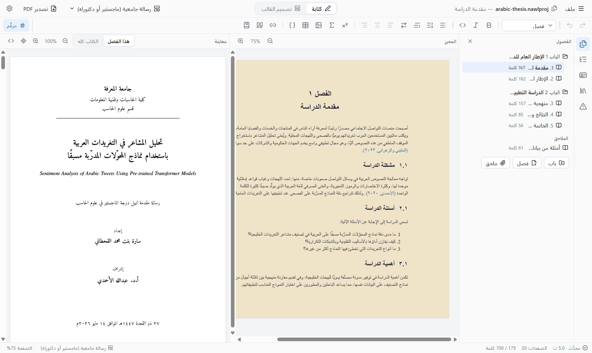

- **ملف ← مشروع جديد…** يطلب قالبًا ومجلدًا. و**فتح المشروع النموذجي** في نافذة
  البداية يعرض مثالًا.
- لوحة **الفصول** تعرض الأبواب والفصول والملاحق. انقر فصلًا لفتحه. الأزرار في الأسفل
  تضيف بابًا أو فصلًا أو ملحقًا، ولكل صف أزرار لنقله وإعادة تسميته وإزالته.
- يستمر الترقيم عبر الفصول. وتصل الإحالات والاستشهادات إلى الفصول الأخرى؛ انقر
  الإحالة مع Ctrl لفتح الفصل الذي تشير إليه.
- معلومات المستند وقائمة المراجع للمشروع كله.
- فوق المعاينة: **هذا الفصل** يبني الفصل المفتوح فقط (أسرع)، و**الكتاب كله** يبني كل
  شيء.
- يمكن **تقسيم** مستند واحد **إلى مشروع**، و**دمج** مشروع **في مستند واحد**، من
  قائمة ملف.

لم يُنجز بعد: البحث عبر الفصول، ومخطط يشمل الفصول الأخرى.

## 16. العروض التقديمية

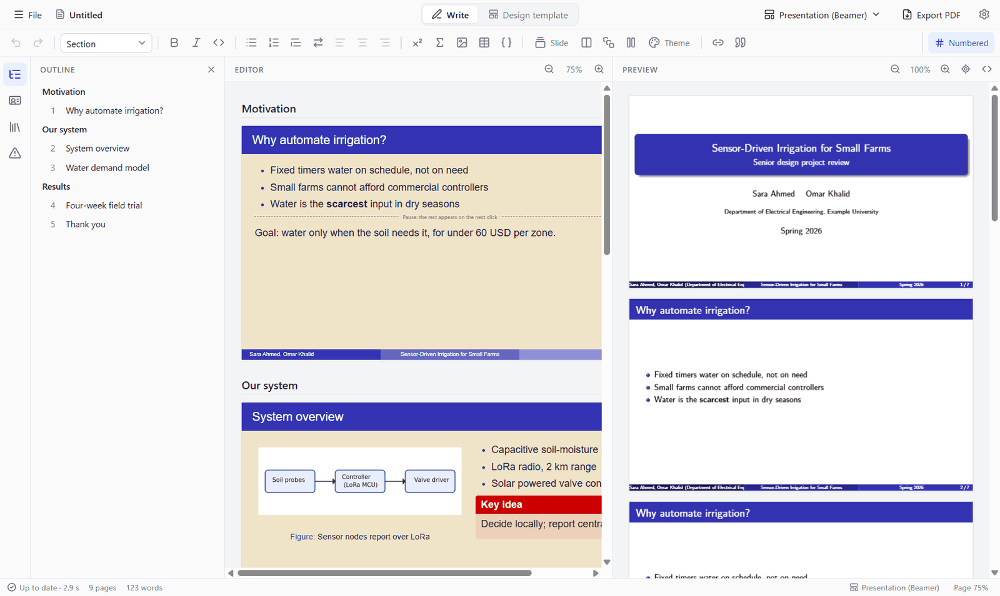

اختر قالب العرض التقديمي من المعرض، أو افتح مثال العرض التقديمي.

- تتوالى الشرائح في الصفحة بشكلها الحقيقي (16:9 أو 4:3)، وبينها عناوين الأقسام. ما
  يتجاوز أسفل الشريحة يظهر على خلفية حمراء لأنه لن يتسع في PDF.
- يضيف شريط الأدوات: **شريحة**، وعمودين، وصندوقًا (تنبيه أو مثال أيضًا)، وتوقفًا (ما
  بعده يظهر في النقرة التالية).
- شريحة العنوان تأتي من **معلومات المستند**: العنوان، والعنوان الفرعي، والمقدّمون،
  والجهة، والتاريخ، والشعار.
- **السمة** يفتح منتقي السمات، بمعاينة حقيقية لكل سمة ولون من Beamer، ولون رئيسي
  تختاره.
- **تصميم القالب ← الشرائح** يضبط التذييل وموضع الشعار وشكل الشريحة وحجم النص.

الشرائح العربية تحتاج إلى LuaLaTeX من تثبيت TeX Live أو MiKTeX.

## 17. الحفظ والتصدير

- **حفظ** (Ctrl+S) يكتب ملف `.nawl`. الصور في مجلد `figures/` بجواره. و**حفظ كملف
  واحد…** يضعها داخل الملف لإرساله ملفًا واحدًا. والملفات التي أُنشئت قبل تسمية البرنامج
  نول (مستندات `.loom` ومشاريع `.loomproj`) تُفتح كما هي.
- **تصدير PDF…** (Ctrl+Shift+E) يحفظ ملف PDF.
- **تصدير LaTeX…** يكتب ملف `.tex` والصنف وكل ما يلزم لبنائه في مكان آخر، للمحرك
  المختار في الإعدادات.
- **تصدير Word…** يكتب ملف `.docx` لمن يطلب Word: عناوين، وفقرات من اليمين إلى
  اليسار، ومعادلات قابلة للتحرير، وأشكال وجداول وتعليقات وقائمة مراجع. لا يفتح
  نول ملفات Word.

**الاسترداد بعد الأعطال.** تُنسخ التغييرات غير المحفوظة إلى مجلد بيانات نول بعد
ثوانٍ من كل تعديل. وإذا أُغلق البرنامج بلا حفظ، يعرض استردادها في المرة التالية.

## 18. الإعدادات

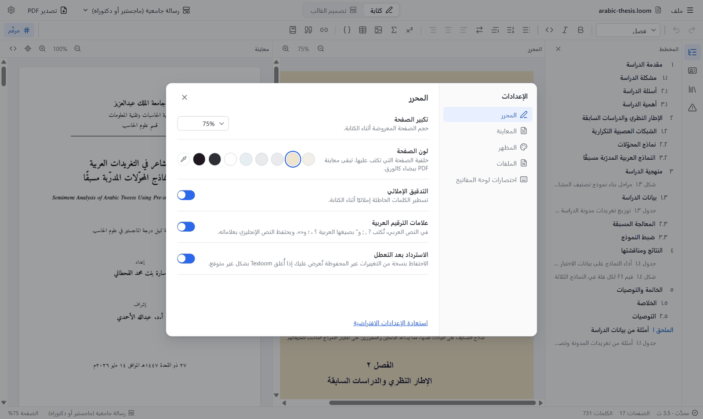

افتحها من أيقونة الترس أو بـ **Ctrl+,**.

| القسم | الإعدادات |
|---|---|
| المحرر | تكبير الصفحة، ولون الصفحة، والتدقيق الإملائي، وعلامات الترقيم العربية، والاسترداد بعد الأعطال |
| المعاينة | البناء أثناء الكتابة أو بـ Ctrl+Enter، ومحرك TeX |
| المظهر | السمة الفاتحة أو الداكنة، والكثافة، ولغة الواجهة |
| الملفات | المجلد الافتراضي، وعدد الملفات الأخيرة |
| اختصارات لوحة المفاتيح | قائمة الاختصارات |

**محرك TeX.** يبني نول بمحرك Tectonic المدمج افتراضيًا. وإذا كان TeX Live أو
MiKTeX أو MacTeX مثبتًا فيمكنك اختيار pdfLaTeX أو XeLaTeX أو LuaLaTeX منه: يستخدم
حزمك المثبتة، ويشغّل حزم الناشرين المصممة لـ pdfLaTeX.

## 19. اختصارات لوحة المفاتيح

| المفاتيح | العمل |
|---|---|
| Ctrl+N | مستند فارغ جديد |
| Ctrl+Shift+N | جديد من قالب |
| Ctrl+O | فتح |
| Ctrl+S / Ctrl+Shift+S | حفظ / حفظ باسم |
| Ctrl+Shift+E | تصدير PDF |
| Ctrl+Enter | البناء الآن |
| Ctrl+J | إظهار موضع المؤشر في PDF |
| Ctrl+F / Ctrl+H | بحث / استبدال |
| Ctrl+Z / Ctrl+Shift+Z | تراجع / إعادة |
| Ctrl+B / Ctrl+I / Ctrl+E | غامق / مائل / كود |
| Ctrl+M | صيغة داخل السطر |
| `$$` ثم مسافة | معادلة في سطر مستقل |
| Ctrl+Shift+X | تبديل اتجاه الفقرة |
| Ctrl+, | الإعدادات |
| F1 | هذا الدليل |

## 20. عند حدوث مشكلة

**البناء الأول بطيء.** القالب الذي يحتاج حزمة لم تأتِ مع نول ينزّلها مرة واحدة،
ويحتاج ذلك إلى الإنترنت. بعدها يصبح البناء سريعًا.

**المعاينة تعرض خطأ.** اقرأ القائمة فوق المعاينة: تشرح معنى الخطأ المعتاد وموضعه.
أكثر الأخطاء تأتي من قالب كود LaTeX أو من أمر LaTeX مكتوب في معادلة.

**النص العربي يظهر مربعات أو بخط خاطئ.** قد لا يحتوي الخط على الحروف. اختر خطًا
عربيًا آخر من **تصميم القالب ← الخطوط**.

**الشرائح العربية لا تُبنى.** تحتاج إلى LuaLaTeX من تثبيت TeX Live أو MiKTeX؛ اختره
من **الإعدادات ← المعاينة**.

**حزمة ناشر لا تُبنى.** كثير من الحزم مصمم لـ pdfLaTeX. ثبّت TeX Live أو MiKTeX واختر
pdfLaTeX من **الإعدادات ← المعاينة**.

**ويندوز يحذّر من ملف التثبيت.** الملف غير موقّع رقميًا بعد. اختر **More info** ثم
**Run anyway**.

**وجدت خطأ؟** أبلغ عنه في
[صفحة المشكلات](https://github.com/abdullah-alahmadi/nawl/issues)، مع الخطوات التي
تؤدي إليه، والمستند إن أمكن.

