# Nawl user guide

**English** · [العربية](help.ar.md)

Nawl is a visual editor for LaTeX documents. You write on a page that looks like the
result, and Nawl produces the LaTeX and the PDF for you. This guide explains every
part of the app. The pictures show version 0.1.

## Contents

1. [Getting started](#1-getting-started)
2. [The window](#2-the-window)
3. [Writing](#3-writing)
4. [Formulas](#4-formulas)
5. [Figures, tables and raw LaTeX](#5-figures-tables-and-raw-latex)
6. [References, citations and cross-references](#6-references-citations-and-cross-references)
7. [Document info](#7-document-info)
8. [The preview](#8-the-preview)
9. [Things to check and LaTeX errors](#9-things-to-check-and-latex-errors)
10. [Find and replace](#10-find-and-replace)
11. [Templates](#11-templates)
12. [Designing a template](#12-designing-a-template)
13. [Arabic documents](#13-arabic-documents)
14. [Arabic mathematics](#14-arabic-mathematics)
15. [Projects: a thesis or book as chapters](#15-projects-a-thesis-or-book-as-chapters)
16. [Presentations](#16-presentations)
17. [Saving and exporting](#17-saving-and-exporting)
18. [Settings](#18-settings)
19. [Keyboard shortcuts](#19-keyboard-shortcuts)
20. [When something goes wrong](#20-when-something-goes-wrong)

---

## 1. Getting started

**Install.** Download the installer for your system from the
[Releases page](https://github.com/abdullah-alahmadi/nawl/releases): `.exe` or `.msi`
for Windows, `.deb` or the snap for Ubuntu. If no release is listed yet, build Nawl
from source as the [README](../README.md#building-from-source) describes. The Windows
installer is not code-signed, so Windows shows a SmartScreen warning the first time:
choose **More info → Run anyway**.

Nothing else is needed. The TeX engine (Tectonic) and the packages the built-in
templates use come with the app, so documents compile without internet.

**The start window.** Nawl opens with a start window.

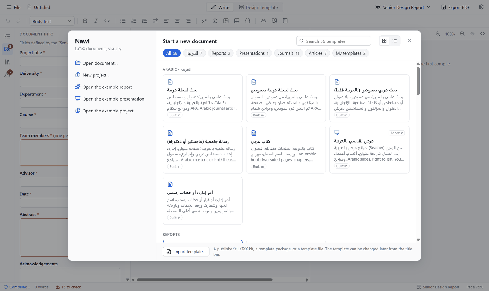

- On the right, **pick a template** to start a new document. The chips at the top
  (العربية, Reports, Presentations, Journals, Articles, My templates) narrow the list,
  and the search box looks through all templates.
- On the left: **Open document…**, **New project…** (a book or thesis with a file per
  chapter), and three examples to explore: a report, a presentation and a project.
  Recent files appear here too.
- Press **Esc** to close the window and start with an empty page.

A good first step is **Open the example report**: it shows headings, a figure, a table,
equations, citations and an appendix.

## 2. The window

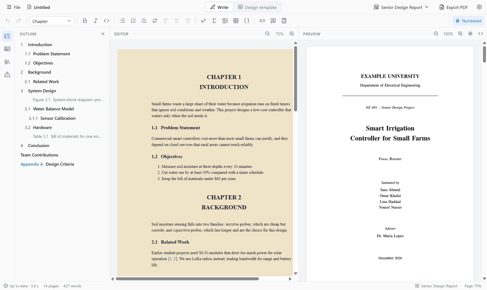

| Part | What it is for |
|---|---|
| **Title bar** | The **File** menu, the document's name, the **Write / Design template** switch, the template button (switches the document to another template), **Export PDF** and **Settings**. |
| **Toolbar** | Undo and redo, the paragraph style, bold / italic / code, lists, text direction, alignment, and the insert buttons (formula, equation, figure, table, raw LaTeX, cross-reference, citation, appendices). |
| **Rail** (far left) | Opens a side panel: **Outline**, **Document info**, **References**, **Things to check**. In a project there is also **Chapters**. |
| **Editor** | The page you write on. It is styled by the template, so it looks like the PDF. Its header has the editor's own zoom buttons. |
| **Preview** | The real PDF, compiled as you type. Its header has zoom, **Show the cursor's place in the PDF** and **Show the generated LaTeX**. |
| **Status bar** | The compile state, page and word counts, the number of things to check, the template, and the page zoom. |

In an Arabic interface the whole window is mirrored: the rail is on the right and the
preview on the left.

## 3. Writing

Type as you would in a word processor. Nawl decides how it looks from the template.

**Paragraph style.** The box at the left of the toolbar sets what the current paragraph
is: *Body text*, *Chapter*, *Section*, *Subsection* and so on. Headings are numbered
for you, and the **Outline** panel lists them; click one to go there.

**Numbered or not.** With the cursor in a heading, the **Numbered** button at the right
of the toolbar turns its number off (for an Acknowledgment or a Preface). It stays in
the table of contents.

**Character formatting.** **Bold** (Ctrl+B), *italic* (Ctrl+I) and `code` (Ctrl+E).

**Lists and quotes.** Bullet list, numbered list and quote buttons. Press Tab to nest a
list item, Shift+Tab to move it back.

**Alignment.** Three buttons align the paragraph left, centre or right. Click the
active one again to return to the template's alignment (usually justified).

**Text direction.** The direction button (or **Ctrl+Shift+X**) switches a paragraph
between left-to-right and right-to-left. See [Arabic documents](#13-arabic-documents).

**Spaces and empty lines.** LaTeX ignores repeated spaces and empty lines, so Nawl
does not let you stack them: Enter on an empty line does nothing, and a second space
is ignored. Pasted text has its runs of spaces reduced to one. Code keeps every space.

**Appendices.** The last toolbar button starts the appendices. Chapters after it are
lettered (Appendix A, B…).

## 4. Formulas

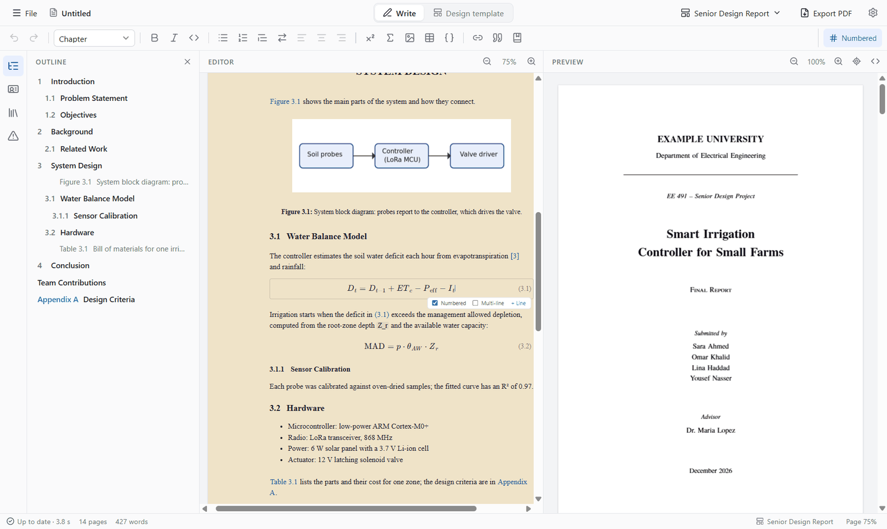

- **Inline formula:** press **Ctrl+M**, or type `$x^2$` inside a sentence.
- **Equation on its own line:** type `$$` and a space, or use the Σ button.
- Click a formula to edit it. You can type LaTeX (`\frac`, `\sqrt`, `\alpha`) or use
  the keyboard as in a formula editor: `/` makes a fraction, `^` a power, `_` an index.
- Hover an equation for its tools: **Numbered** turns the number on or off,
  **Multi-line** makes an aligned derivation, and **+ Line** adds a line to it.
- Numbered equations can be referred to with a cross-reference, which shows "(3.2)".

## 5. Figures, tables and raw LaTeX

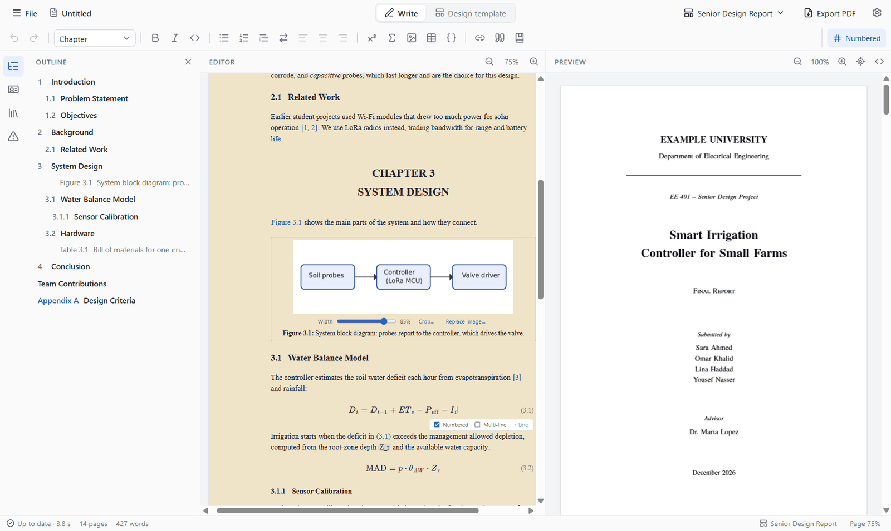

**Figures.** The image button asks for a picture (PNG, JPG or PDF). Type the caption
under it. The slider under the picture sets its width, and **Crop…** cuts off its
edges by dragging. Images are copied into a `figures/` folder next to your document.

**Tables.** The table button inserts a table with a caption above it. While the cursor
is in the table, buttons to add and remove rows and columns appear at the right of the
toolbar. Drag across cells and press **Merge** to join them, across rows and columns.

**Raw LaTeX.** The `{ }` button inserts a block that is written into the PDF exactly
as typed. Use it for TikZ drawings or anything Nawl has no button for.

## 6. References, citations and cross-references

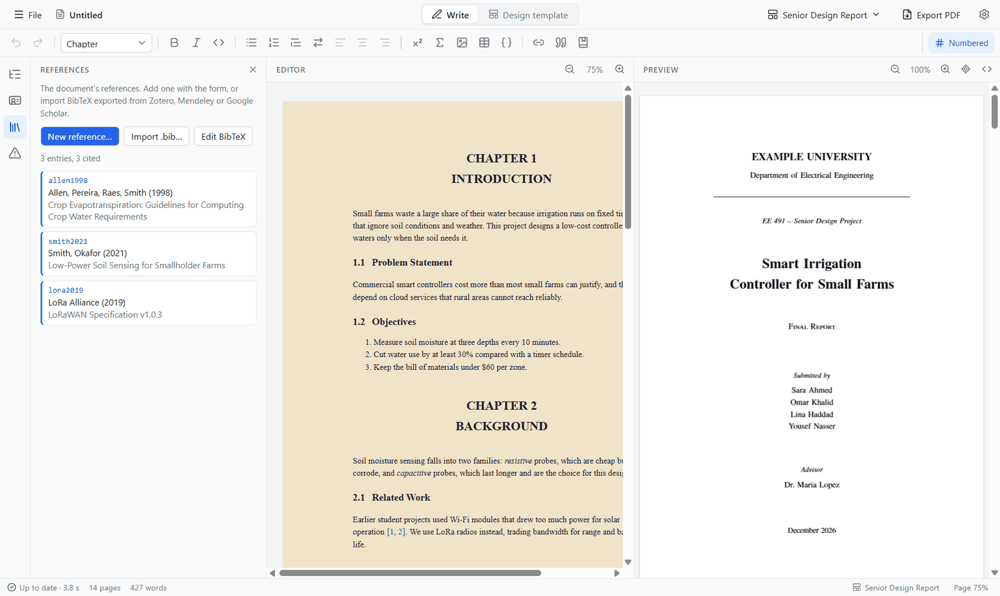

**The reference list.** Open **References** in the rail.

- **New reference…** opens a form for a journal article, conference paper, book,
  chapter, thesis, report or website, with a row for each author. The citation key is
  made from the first author, the year and the title.
- **Import .bib…** or **Edit BibTeX** take references exported from Zotero, Mendeley or
  Google Scholar.
- Click a reference to edit or delete it.

**Citing.** Put the cursor where the citation belongs and press the citation button,
then choose the reference. The template decides the style (IEEE numbers, author–year,
APA…), and the reference list is printed at the end of the document.

**Cross-references.** The link button inserts "Figure 3.1", "Chapter 2", "Table 3.1"
or "(3.2)". The number stays correct when things move. Ctrl-click a reference to jump
to what it points at.

## 7. Document info

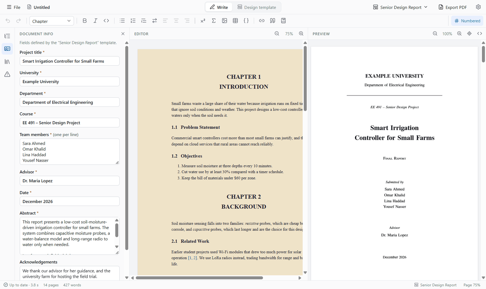

The title, authors, abstract, supervisor, date and the like are not typed on the page.
They are **fields** that the template defines, filled in under **Document info** in the
rail. The template puts them on the title page and the front matter. Fields marked
with a red star are required.

Journal templates have a row per author with affiliation, e-mail, ORCID and
corresponding author. A **Date** field has a date picker. An **image** field (a
university logo, for example) lets you pick a picture.

## 8. The preview

The preview is the real PDF. It recompiles shortly after you stop typing.

- **Double-click the PDF** to put the cursor at that place in the editor.
- **Ctrl+J** (or the target button) scrolls the PDF to the cursor's place and marks it.
- The zoom buttons and **Fit width** are in the preview's header. The editor has its
  own zoom in its header.
- **Show the generated LaTeX** (the `<>` button) shows the LaTeX code Nawl writes,
  with a **Copy code** button.
- To compile only when you ask, turn off compiling while typing in **Settings →
  Preview** and press **Ctrl+Enter**.

## 9. Things to check and LaTeX errors

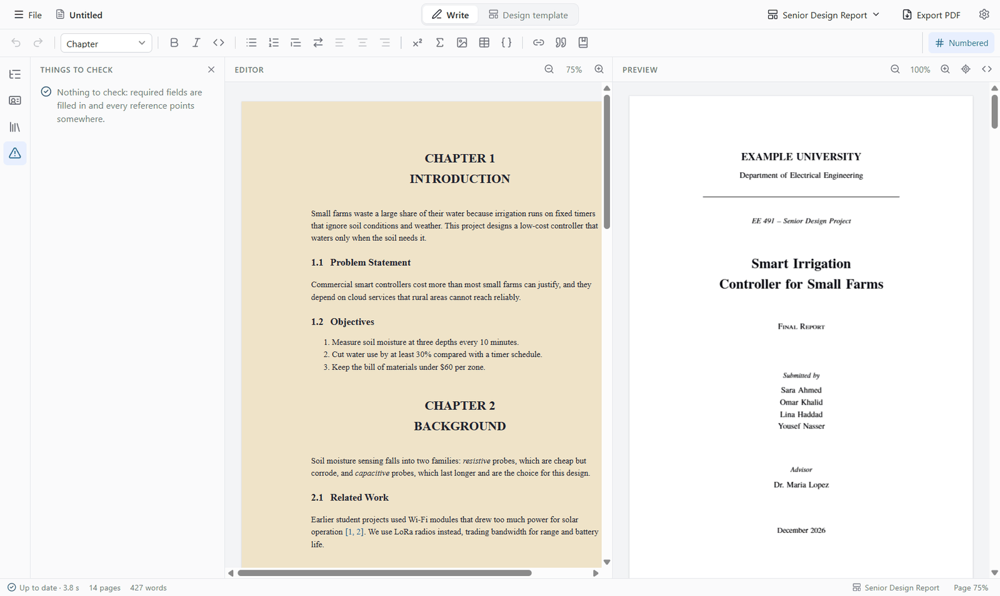

**Things to check** in the rail (and the count in the status bar) lists what the
document still needs: required fields that are empty, cross-references whose target is
gone, citations without an entry. Click an item to go to it.

When LaTeX reports an error, the list above the preview says what it usually means and
where it is ("in Heading “Results”"). Click it to go there.

## 10. Find and replace

**Ctrl+F** finds text in headings, paragraphs, captions and tables. **Ctrl+H** also
replaces, one match at a time or all at once (one undo brings them all back).

In Arabic text the search ignores diacritics and tatweel and treats أ إ آ ا, ة/ه and
ى/ي as the same letter, so "محمد" finds "مُحَمَّدٌ". **Match exactly** turns this off.

## 11. Templates

A template decides the page, the fonts, the headings, the title page, the front matter
and the fields. A document remembers its template, and you can switch it at any time
with the template button in the title bar.

**File → New from template…** (Ctrl+Shift+N) opens the gallery:

| Kind | Templates |
|---|---|
| Arabic | Journal article (one and two columns), thesis, book, administrative order, presentation |
| Reports | Senior Design Report, Engineering Graduation Project Report |
| Articles | Article, Two-column Article, Short Paper |
| Journals | IEEE journal and conference, Elsevier, ACM, Springer LNCS, APS Physical Review |
| Presentations | Beamer presentation |
| My templates | The ones you made or imported |
| From your TeX installation | The classes of an installed TeX Live, grouped by kind |

Journal templates use the publisher's official class, so the layout is exactly the
publisher's. Nawl writes the title block, authors, abstract, keywords and the
bibliography in the publisher's format.

**Import template…** adds a template to My templates. It accepts a publisher's LaTeX
kit (the .zip from a journal's author guidelines), a template package someone exported
from Nawl, or a Nawl template file. **Export template…** saves the current
template as a .zip to share.

## 12. Designing a template

Switch to **Design template** at the top. Every change updates the preview, and
problems appear next to the control that caused them.

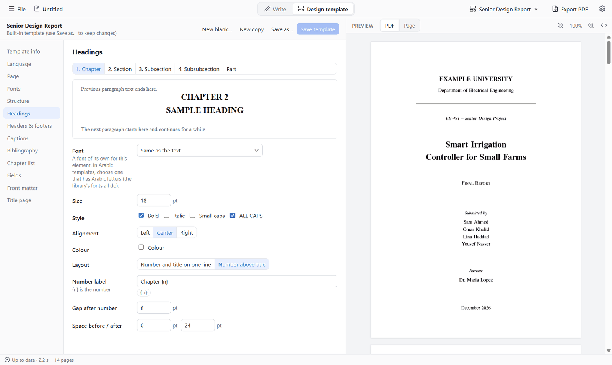

| Section | What you set |
|---|---|
| Template info | Name and description |
| Language | Main and second language, digits, formula style (see below) |
| Page | Paper, margins, one or two columns, line spacing |
| Fonts | Text, sans-serif, monospace and Arabic fonts, and the size |
| Structure | Chapters or sections at the top, numbering depth, cover pages |
| Headings | Each level's font, size, alignment, colour, label and spacing |
| Headers & footers | What the top and bottom of each page show |
| Captions | Figure and table labels and their style |
| Bibliography | Citation style, one list per language |
| Chapter list | How chapters and parts look in a project |
| Fields | The fields of Document info |
| Front matter | Abstract, acknowledgements, contents, lists of figures and tables |
| Title page | A drag-and-drop canvas |

**The title page** is a canvas. Add text, images and lines, drag them into place, and
set their text and style on the right. Items snap to the page's centre and margins and
to each other. Text can contain fields such as `{title}` or `{supervisor}`.
**+ Fixed page** adds another page laid out the same way: an approval page or a
declaration.

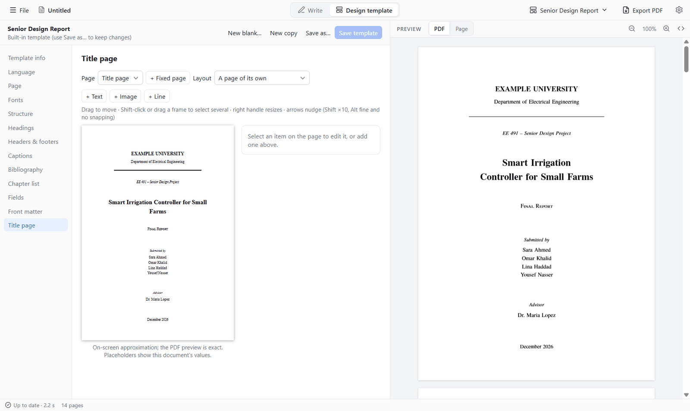

**Front matter** lists the pages before chapter 1 in order. Move them with the arrows.

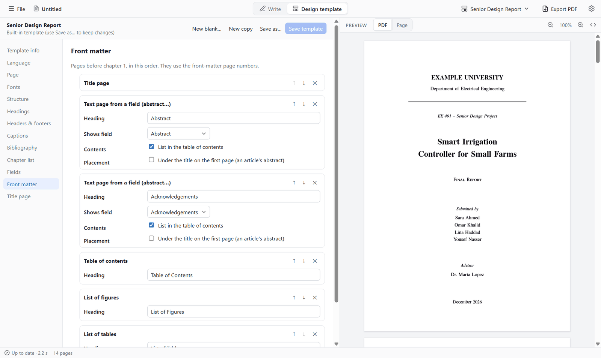

**Saving.** Built-in templates can't be changed in place. **New copy** starts a copy of
the current template and **New blank…** starts from an empty one. **Save as…** stores
it in **My templates**, where it appears in the gallery.

## 13. Arabic documents

Nawl is built Arabic first. Arabic and mixed Arabic and English documents are set
right to left, with Arabic fonts, headings, labels, numbers and references.

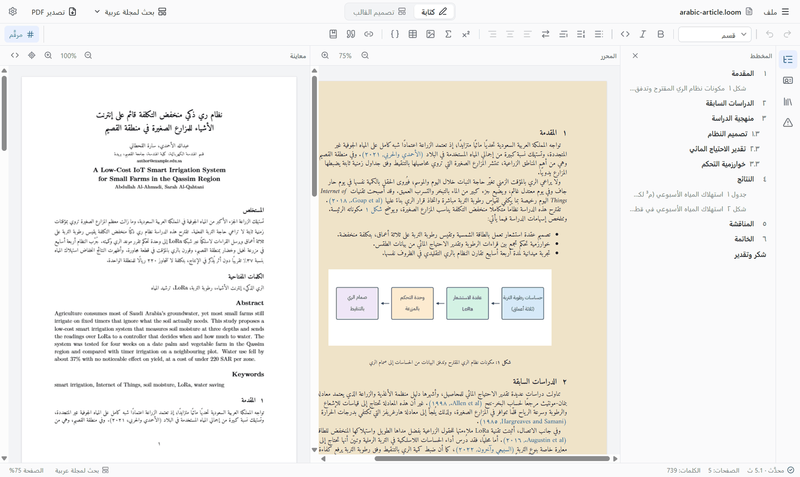

**The interface.** **Settings → Appearance → Language** switches the interface to
Arabic. By default it follows your system's language.

**Templates.** The gallery's **العربية** category has a journal article (one and two
columns), a thesis, a book, an administrative order (أمر إداري) and a presentation.
Any template can be made Arabic in the designer's **Language** section.

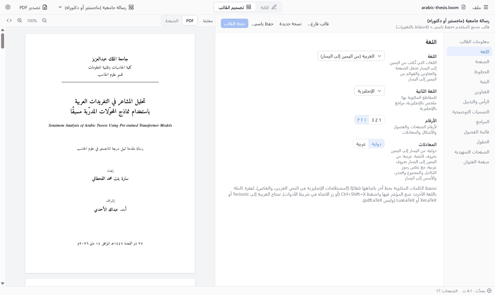

**Typing.** Type Arabic and English freely. Nawl finds the English words and marks
them for LaTeX itself. For a whole paragraph in the other language press
**Ctrl+Shift+X**. In Arabic text, `?` `,` `;` and `"` become ؟ ، ؛ and «»; English
words and numbers keep their own marks. Settings → Editor turns this off.

**Fonts.** The designer's **Fonts** section shows a gallery of 32 Arabic fonts, each in
its own face: Amiri (the default) and 31 free fonts that come with Nawl. Their
files go with the document, so it looks the same on any computer. Installed fonts work
too. Headings and title-page items can each have a font of their own.

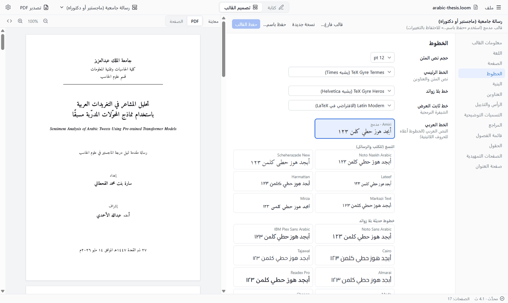

**Digits.** The Language section chooses Arabic-Indic (١٢٣) or Western (123) digits
for page, chapter, figure and equation numbers. Section numbers read with the chapter
on the right: section 1 of chapter 2 is ١.٢.

**References.** Arabic entries are formatted in Arabic (وآخرون، د.ت.) and English ones
in English. A template can print a list for each language.

**Dates.** A date field is written in the document's language, and can also be shown
in the Hijri calendar (Umm al-Qura).

**Authors in two languages.** In Arabic templates each author also has an English name
and affiliation.

**Administrative orders.** The أمر إداري template has a letterhead with the logo, the
number and date in both calendars, the subject, the body and the signature.

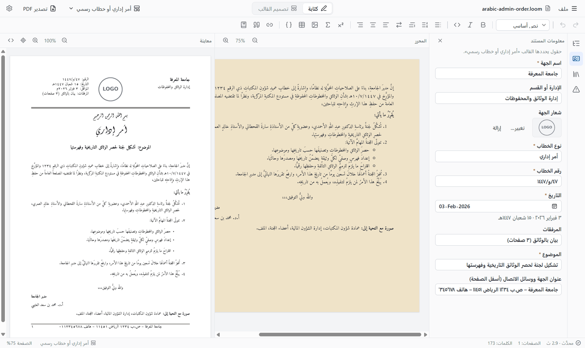

**Engines.** Arabic needs XeLaTeX or LuaLaTeX. The built-in engine is XeLaTeX, so
nothing needs setting. Arabic slides need LuaLaTeX from an installed TeX Live or
MiKTeX.

## 14. Arabic mathematics

Formulas can be written the Arabic way: right to left, with mirrored integrals, sums,
roots and limits, Arabic function names (جا، جتا، ظا، لو، نهـــا) and variables in a
font of their own.

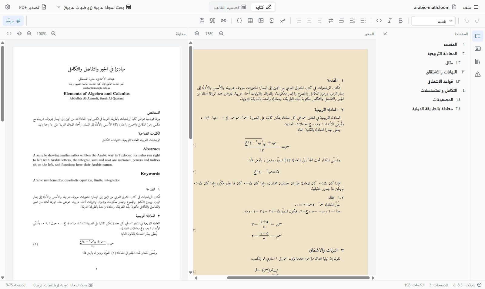

**Turning it on.** In the designer's **Language** section set **Formulas** to
**Arabic**. The variables' font is chosen there too (Aref Ruqaa by default, so letters
stand apart from the text). When you change the setting, Nawl offers to convert the
letters of the formulas already in the document (x → س, or back).

**One formula.** Click a formula to open its helper. **عربية / دولية** switches that
formula between the Arabic and the international style whatever the template says. The
palette inserts Arabic function names and symbols, and **x → س** converts the letters
of this formula or of all formulas.

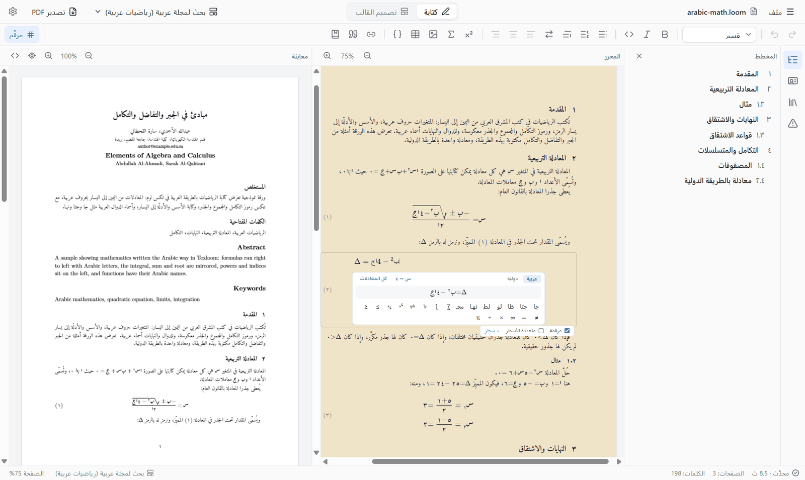

**In Word.** Word can't lay these formulas out, so Export Word places them as pictures.

**Limits.** Arabic mathematics on slides is untested. The example
`examples/arabic-math.loom` shows what is covered.

## 15. Projects: a thesis or book as chapters

A long document can be a **project**: a folder with a project file (`.loomproj`) and
one file per chapter. Each chapter opens on its own, so writing stays fast, and the
chapters can be reordered, backed up or shared separately.

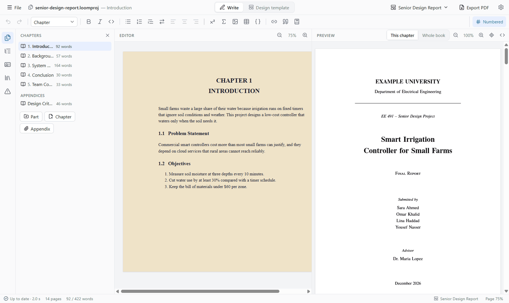

- **File → New project…** asks for a template and a folder. **Open the example
  project** in the start window shows one.
- The **Chapters** panel lists parts, chapters and appendices. Click a chapter to open
  it. The buttons at the bottom add a part, a chapter or an appendix; each row has
  buttons to move, rename or remove it.
- Numbers continue across chapters. Cross-references and citations reach the other
  chapters; Ctrl-click one to open the chapter it points at.
- Document info and the reference list belong to the whole project.
- Above the preview, **This chapter** compiles only the open chapter (fast) and
  **Whole book** compiles everything.
- A single document can be split into a project, and a project joined into one
  document, from the File menu.

Not there yet: search across chapters and an outline that includes the other chapters.

## 16. Presentations

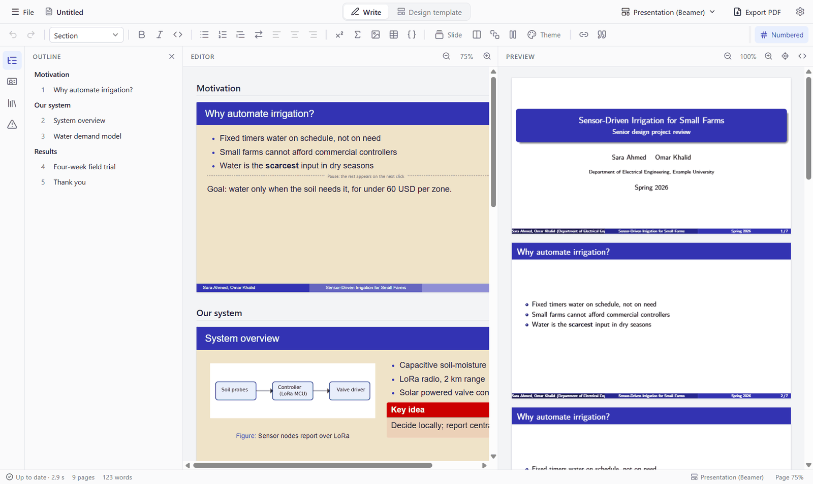

Choose **Presentation (Beamer)** in the gallery, or open the example presentation.

- Slides run down the page at their real shape (16:9 or 4:3), with section headings
  between them. Content that runs past the bottom of a slide sits on a red tint,
  because it won't fit in the PDF.
- The toolbar adds **Slide**, **two columns**, a **box** (a block; alert or example
  too) and a **pause** (what follows appears on the next click).
- The title slide comes from **Document info**: title, subtitle, presenters,
  institution, date and a logo.
- **Theme** opens the theme picker, with a real preview of every beamer theme and
  colour theme, and a main colour of your own.
- **Design template → Slides** sets the footer, the logo's place, the slide shape and
  the text size.

## 17. Saving and exporting

- **Save** (Ctrl+S) writes a `.loom` file. Images are in a `figures/` folder next to
  it. **Save as single file…** puts them inside the file, to send one file.
- **Export PDF** (Ctrl+Shift+E) saves the PDF.
- **Export LaTeX…** writes the `.tex`, the class and everything needed to compile it
  elsewhere, for the engine chosen in Settings.
- **Export Word…** writes a `.docx` for those who ask for Word: headings, right-to-left
  paragraphs, editable equations, figures, tables, captions and the reference list.
  Nawl does not open Word files.

**Crash recovery.** Unsaved changes are copied to Nawl's data folder a few seconds
after each edit. If Nawl closes without saving, it offers to restore them next time.

## 18. Settings

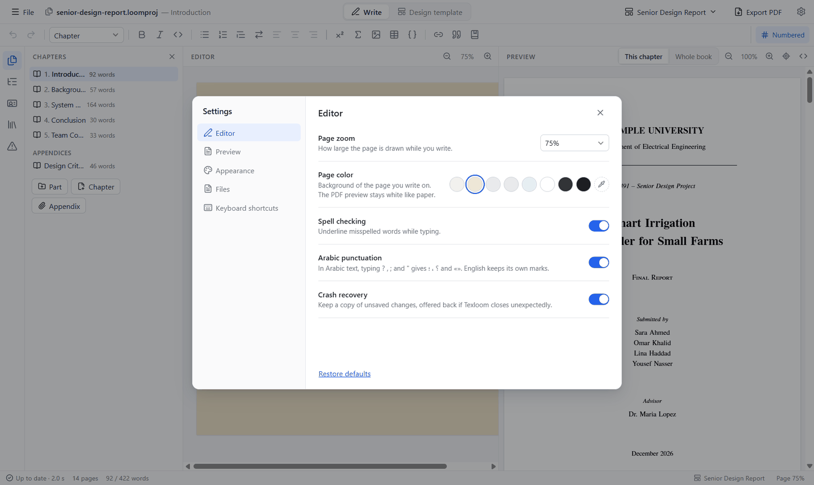

Open with the gear icon or **Ctrl+,**.

| Section | Settings |
|---|---|
| Editor | Page zoom, page colour, spell checking, Arabic punctuation, crash recovery |
| Preview | Compile while typing or on Ctrl+Enter, the TeX engine |
| Appearance | Light or dark theme, density, interface language |
| Files | Default folder, number of recent files |
| Keyboard shortcuts | The list of shortcuts |

**TeX engine.** Nawl compiles with the built-in Tectonic by default. If TeX Live,
MiKTeX or MacTeX is installed you can choose its pdfLaTeX, XeLaTeX or LuaLaTeX
instead: it uses your installed packages and runs publisher kits made for pdfLaTeX.

## 19. Keyboard shortcuts

| Keys | Action |
|---|---|
| Ctrl+N | New empty document |
| Ctrl+Shift+N | New from template |
| Ctrl+O | Open |
| Ctrl+S / Ctrl+Shift+S | Save / Save as |
| Ctrl+Shift+E | Export PDF |
| Ctrl+Enter | Compile now |
| Ctrl+J | Show the cursor's place in the PDF |
| Ctrl+F / Ctrl+H | Find / Replace |
| Ctrl+Z / Ctrl+Shift+Z | Undo / Redo |
| Ctrl+B / Ctrl+I / Ctrl+E | Bold / Italic / Code |
| Ctrl+M | Inline formula |
| `$$` then space | Equation on its own line |
| Ctrl+Shift+X | Switch the paragraph's direction |
| Ctrl+, | Settings |
| F1 | This guide |

## 20. When something goes wrong

**The first compile is slow.** A template that needs a package Nawl did not ship
downloads it once; this needs internet. Later compiles are fast.

**The preview shows an error.** Read the list above the preview: it says what the
error usually means and where it is. Most errors come from a raw LaTeX block or from
LaTeX typed into a formula.

**Arabic text shows as boxes or in the wrong font.** The font may lack the letters.
Choose another Arabic font in **Design template → Fonts**.

**Arabic slides do not compile.** They need LuaLaTeX from an installed TeX Live or
MiKTeX; choose it in **Settings → Preview**.

**A publisher's kit does not compile.** Many kits are made for pdfLaTeX. Install TeX
Live or MiKTeX and choose pdfLaTeX in **Settings → Preview**.

**Windows warns about the installer.** The installer is not code-signed yet. Choose
**More info → Run anyway**.

**Found a bug?** Report it in the
[repository's issues](https://github.com/abdullah-alahmadi/nawl/issues), with the
steps that lead to it and, if you can, the document.
